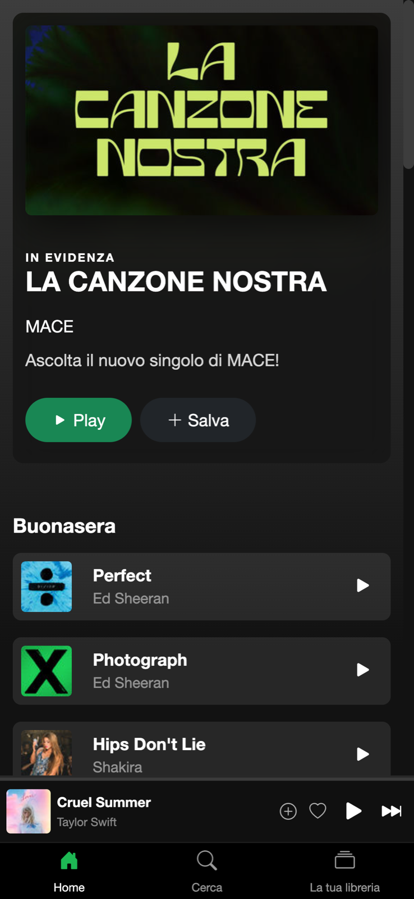

<h1 align="center">
    
</h1>

Un clone di Spotify interamente client-side: catalogo musicale, album, artisti, ricerca, player audio, brani che ti piacciono, libreria e playlist personali.


**👉 [Visualizza la versione live del progetto](https://4-1-build-week-ch-1.vercel.app/)**

## 📋 Descrizione

Il progetto replica l'esperienza di Spotify con HTML, CSS e JavaScript vanilla, senza framework applicativi né build step. Bootstrap gestisce griglia e componenti, mentre i dati arrivano da un adattatore API isolato in un unico file: oggi usa Deezer tramite il proxy didattico di Strive School, domani può usare qualsiasi provider senza toccare le pagine.

Tutto ciò che riguarda la libreria personale (brani che ti piacciono, album salvati, artisti seguiti, playlist) viene salvato in `localStorage`.

## 🚀 Tecnologie Utilizzate

- **HTML5**: pagine semantiche e accessibili
- **CSS3**: griglia, layout responsive e variabili
- **JavaScript (ES6+)**: logica, player audio, chiamate API
- **Bootstrap 5**: griglia e componenti
- **Bootstrap Icons**: set di icone
- **Fetch API + AbortController**: richieste asincrone con timeout
- **localStorage**: preferiti, album, artisti e playlist
- **sessionStorage**: continuità della riproduzione tra una pagina e l'altra
- **Media Session API**: controlli da lock screen e tasti multimediali

## ⚙️ Caratteristiche

- Home con album in evidenza, ascolti recenti, selezione di album e brani in tendenza
- Ricerca con debounce e categorie sfogliabili, con le immagini originali del progetto
- Pagina artista con brani più ascoltati, discografia e pulsante "Segui"
- Pagina album con tracklist completa, durata e salvataggio nella libreria
- Player condiviso: play/pausa, precedente/successivo, seek, shuffle, repeat, volume e mute
- **Brani che ti piacciono**: pagina dedicata con play, rimozione e durata totale
- **La tua libreria**: playlist, album salvati e artisti seguiti
- **Playlist personali**: creazione, aggiunta e rimozione brani, eliminazione
- **Doppio provider**: Deezer per il catalogo mainstream con anteprime, Audius per brani completi
- Badge nel player: **Anteprima 30s** oppure **Brano completo**
- Aggiunta del brano corrente a una playlist dal player o dalle tracce di un album
- Riproduzione che continua quando si cambia pagina
- Recupero automatico delle anteprime scadute tramite l'API
- Mini player e barra di navigazione inferiore su mobile, senza menu hamburger
- Layout responsive con breakpoint a 1200, 992, 768 e 576 px
- Messaggi di errore, stati di caricamento e toast espliciti

## 🛠️ Installazione

```bash
# Clona il repository
git clone https://github.com/henry8913/4.1_Build-Week-CH1.git

# Entra nella cartella
cd 4.1_Build-Week-CH1

# Avvia un server locale (consigliato: il progetto usa fetch)
python3 -m http.server 8000
```

Poi apri [http://localhost:8000](http://localhost:8000) nel browser. In alternativa puoi usare l'estensione Live Server di VS Code oppure `npm start`.

Per eseguire i controlli di base (link, id duplicati e sintassi JavaScript):

```bash
npm run check
```

## 🖥️ Utilizzo

- **Home**: album in evidenza, ascolti recenti, album e brani in tendenza
- **Cerca**: ricerca libera e categorie
- **Pagina Artista**: brani popolari, discografia, "Segui"
- **Pagina Album**: tracklist, Play e "Salva"
- **Brani che ti piacciono**: tutti i brani salvati con il cuore
- **La tua libreria**: playlist, album e artisti
- **Player**: barra fissa su desktop, mini player su mobile

## 🔌 Provider musicale

L'app supporta due provider intercambiabili, selezionabili da **Sorgente** nella sidebar (desktop), dalla barra in alto nella Home (mobile) o nella pagina **La tua libreria**:

| Provider | Brani | Catalogo | Chiave API |
|---|---|---|---|
| **Deezer** (default) | Anteprime da 30 secondi | Mainstream | Nessuna (proxy didattico) |
| **Audius** | **Brani completi** | Indipendente: elettronica, lofi, hip-hop, house, remix | Nessuna |

La scelta viene salvata in `localStorage` e il player mostra un badge **Anteprima 30s** oppure **Brano completo**. I brani salvati nei preferiti restano riproducibili anche dopo aver cambiato provider, perché ogni traccia conserva il proprio provider.

### Aggiungere un altro provider

Tutte le chiamate passano da **`js/music-api.js`**. Le pagine ricevono solo oggetti normalizzati:

- `Track`: `{ id, title, artist, album, duration, streamUrl, preview, provider }`
- `Album`: `{ id, title, cover, coverSmall, artist, year, releaseDate, copyright, tracks }`
- `Artist`: `{ id, name, fans, picture, pictureMedium, pictureSmall }`

Per aggiungere un provider:

1. Crea un nuovo oggetto provider in `js/music-api.js` con `search`, `getAlbum`, `getArtist`, `getArtistTop`, `getArtistAlbums`, `getTrack` e `resolveStream`.
2. Fai restituire l'URL riproducibile in `streamUrl` (anteprima o brano completo).
3. Aggiungilo all'oggetto `PROVIDERS`.

Player, pagine, preferiti, libreria e playlist non vanno modificati. La funzione `resolveStream` gestisce già il rinnovo degli URL scaduti per Deezer.

## 📸 Screenshot



## 💻 Struttura del Progetto

```
4.1_Build-Week-CH1/
├── css/
│   ├── style.css        # Stili globali, layout, modali e responsive
│   ├── player.css       # Player desktop e mini player mobile
│   ├── album.css        # Pagina album
│   ├── artist.css       # Pagina artista
│   ├── search.css       # Pagina di ricerca
│   └── collection.css   # Preferiti, libreria e playlist
├── js/
│   ├── utils.js         # Utility generiche e storage
│   ├── music-api.js     # Adattatore API musicale (unico punto da cambiare)
│   ├── library.js       # Preferiti, album, artisti e playlist
│   ├── layout.js        # Sidebar, header, player bar, modali
│   ├── player.js        # Motore audio e controlli
│   ├── script.js        # Home
│   ├── album.js         # Pagina album
│   ├── artist.js        # Pagina artista
│   ├── search.js        # Pagina di ricerca
│   ├── liked.js         # Brani che ti piacciono
│   ├── library-page.js  # La tua libreria
│   └── playlist.js      # Playlist personali
├── img/                 # Copertine, immagini categorie e avatar
├── scripts/check.js     # Controlli di link, id e sintassi
├── .github/workflows/   # CI dei controlli
├── index.html           # Homepage
├── album.html           # Pagina album
├── artist.html          # Pagina artista
├── search.html          # Pagina di ricerca
├── liked.html           # Brani che ti piacciono
├── library.html         # La tua libreria
├── playlist.html        # Playlist personale
└── README.md
```

### Note tecniche

- `js/layout.js` inietta sidebar, header, colonna amici e player bar in tutte le pagine.
- Su mobile non esiste menu hamburger: la navigazione resta nella barra inferiore, come nel design originale del progetto.
- Tutti i dati provenienti dall'API e le query utente vengono escapati prima di essere inseriti nel DOM.
- Lo stato del player viene salvato in `sessionStorage`, così la riproduzione continua tra le pagine.
- L'anteprima audio fornita da Deezer dura circa 30 secondi: è una limitazione del servizio, non del player.

### Limiti noti

- Deezer viene raggiunto tramite un proxy non ufficiale (`striveschool-api.herokuapp.com`) e fornisce solo anteprime da 30 secondi.
- Audius offre brani completi, ma il catalogo è indipendente: non contiene i successi delle major (si trovano remix, cover e type beat).
- La disponibilità di copertine e stream Audius dipende dai nodi della rete Audius.
- La sezione "I tuoi episodi" è un segnaposto in attesa di un provider podcast.
- La colonna "Attività amici" usa dati dimostrativi statici.
- I controlli automatici coprono link, id duplicati e sintassi JavaScript, ma non sono test end-to-end.

## 🤝 Contributi

Le contribuzioni sono sempre benvenute! Apri una **issue** o invia una **pull request** per suggerire modifiche.

### 👨‍💻 Contributori

- [PaolaTaralloo](https://github.com/PaolaTaralloo)
- [SPIRIDION](https://github.com/SPIRIDION)
- [majoralpaca984](https://github.com/majoralpaca984)
- [henry8913](https://github.com/henry8913)
- [SilkySmooth91](https://github.com/SilkySmooth91)

---

## 👤 Autori

Progetto demo creato da [Team 1 - 4.1 Build Week CH1](https://4-1-build-week-ch-1.vercel.app/) per scopi didattici.

## 📝 Licenza

Questo progetto è distribuito sotto licenza [MIT](LICENSE.txt). Vedi il file `LICENSE.txt` per ulteriori dettagli.
